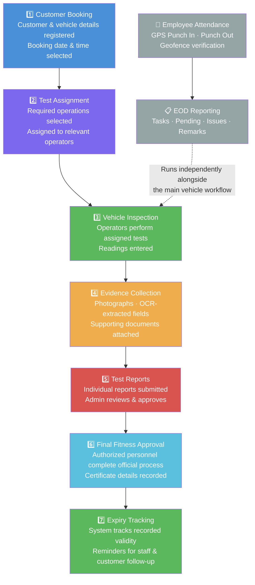
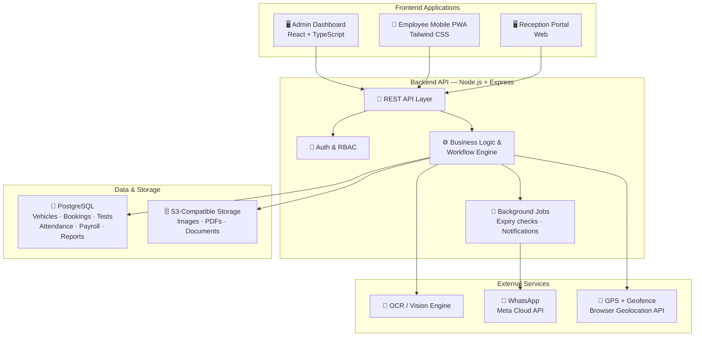
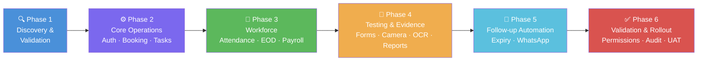

# ATS Operations Management System
## Software Requirements Specification (SRS)

**Document Type:** Software Requirements Specification (SRS)  
**Version:** 1.0 — Initial Scope Draft  
**Prepared for:** Client Discussion, Estimation & Technical Planning  
**Date:** November 2026  
**Status:** 🟡 Subject to Client Validation — 6 open clarifications pending

---

> [!IMPORTANT]
> This SRS captures requirements described during the initial client discussion. Items that depend on government rules, official ATS systems, testing equipment or client policies are **marked for confirmation rather than assumed**.
>
> This is an **internal operational management platform**. It does **not** replace official ATS testing equipment, statutory testing software, or government certificate issuance systems.

---

## Table of Contents

1. [Project Overview](#1-project-overview)
2. [User Roles & Access Control](#2-user-roles--access-control)
3. [Functional Modules](#3-functional-modules)
   - [Module 1 — Vehicle Booking & Customer Management](#module-1--vehicle-booking--customer-management)
   - [Module 2 — Employee Management, GPS Attendance & Payroll](#module-2--employee-management-gps-attendance--payroll)
   - [Module 3 — Test-wise Task Allocation & Workflow](#module-3--test-wise-task-allocation--workflow-management)
   - [Module 4 — AI Camera & Data Extraction](#module-4--ai-camera--automatic-data-extraction)
   - [Module 5 — Test Reports & Documentation](#module-5--test-reports--documentation)
   - [Module 6 — Fitness Certificate & Expiry Management](#module-6--final-fitness-report--expiry-management)
   - [Module 7 — WhatsApp Business API & Communication](#module-7--whatsapp-business-api--customer-communication)
   - [Module 8 — Admin Dashboard & Analytics](#module-8--admin-dashboard--analytics)
4. [End-to-End Operational Workflow](#4-end-to-end-operational-workflow)
5. [Non-Functional Requirements](#5-non-functional-requirements)
6. [Technical Architecture](#6-suggested-technical-architecture)
7. [Development Scope & Exclusions](#7-initial-development-scope--exclusions)
8. [Compliance, Security & Integrations](#8-compliance-security--external-integrations)
9. [Client Clarification Checklist](#9-client-clarification-checklist)
10. [Recommended Implementation Approach](#10-recommended-implementation-approach)

---

## 1. Project Overview

The proposed **ATS Operations Management System** is a centralized platform for managing the day-to-day operations of a vehicle fitness testing facility. It will digitize vehicle bookings, employee attendance, test-wise task allocation, evidence collection, report management, certificate-validity tracking and customer communication.

The system is intended to improve **operational visibility**, reduce manual data entry, create **traceable testing records**, and help the facility contact customers before recorded fitness validity expires.

### 1.1 Project Objectives

- Centralize customer, vehicle and booking records
- Allocate individual vehicle tests to the relevant operators
- Provide employees with a simple **mobile interface** for GPS-supported attendance and EOD reporting
- Capture test readings, photographs and reports against the correct vehicle and operation
- Use **OCR/AI** to assist with number-plate and document-data extraction
- Track final report and certificate details, including recorded expiry dates
- Automate approved customer notifications through the **official WhatsApp Business Platform**
- Give administrators a consolidated view of bookings, testing progress, employees and alerts

### 1.2 Project Boundary

> [!WARNING]
> The proposed product is an **internal operations and management platform**. It is not assumed to replace certified ATS testing equipment, statutory testing software, an official government portal, or the legally authorized certificate-issuance process. Any such integration must be confirmed with the client and relevant authority.

### Project Scope at a Glance

| Parameter | Details |
|---|---|
| Employee Capacity | Up to 25 (initial) |
| Primary Users | Admin + Operators |
| Platform | Web application + Mobile-friendly PWA |
| Automation | AI/OCR + GPS Geofence + WhatsApp |

---

## 2. User Roles & Access Control

The system uses **Role-Based Access Control (RBAC)**. Permissions must be configurable so that each user can access only the functions and records required for their role.

| Role | Primary Permissions |
|---|---|
| **Super Admin** | Full system configuration, users, permissions, settings and all records |
| **Admin / Manager** | Bookings, employee oversight, task allocation, reports, payroll and dashboards |
| **Reception / Booking Staff** | Customer & vehicle registration, booking creation and schedule updates |
| **Brake Test Operator** | Assigned brake-test queue, readings, evidence and report submission |
| **Light Test Operator** | Assigned light-test queue, readings, evidence and report submission |
| **Speed Test Operator** | Assigned speed-test queue, readings, evidence and report submission |
| **Other Test Operators** | Only the testing operations assigned to that operator |
| **HR / Payroll** | Employee attendance, leave, salary configuration and payroll processing |

### Access Control Requirements

- Operators shall **not** view or modify other departments' test records unless explicitly authorized
- Administrators shall be able to view the **complete operational pipeline**
- Sensitive actions, report changes and administrative corrections shall be recorded in an **audit log**
- Finalized reports shall **not be editable** by ordinary operators

---

## 3. Functional Modules

---

### Module 1 — Vehicle Booking & Customer Management

**Used by:** Reception / Booking Staff, Admin

#### Core Functionality

- Create and maintain customer profiles (name, phone number, address)
- Register vehicle registration number, category (LMV / HMV / Transport), and vehicle details
- Upload and maintain supporting vehicle/customer documents
- Create a booking with date, expected arrival time and booking notes
- Select required testing operations and assign the relevant operators
- Generate a **unique internal booking ID** and maintain booking history
- Reschedule or cancel bookings, recording the user, timestamp and reason
- View bookings by date, vehicle, customer, status and assigned operation

#### Booking Workflow

```
Reception Creates Customer & Vehicle Record
        ↓
Reception Schedules Booking & Selects Required Tests
        ↓
System Generates Booking ID → Creates Operation-Level Tasks
        ↓
Tasks Appear in Relevant Operators' Work Queues
        ↓
Vehicle Progresses Through the Configured Testing Workflow
```

#### Booking Data Fields

| Field | Type | Notes |
|---|---|---|
| Customer Name | Text | Required |
| Phone Number | Phone | For WhatsApp communications |
| Address | Text | — |
| Vehicle Reg. No. | Text | Unique; Indian format validated |
| Vehicle Category | Enum | LMV, HMV, Transport, etc. |
| Booking Date | Date | — |
| Expected Arrival | Time | — |
| Booking Notes | Text | Optional |
| Booking ID | Auto | System-generated unique ID |
| Operations Assigned | Multi-select | Linked to operator roles |
| Status | Enum | Scheduled / In Progress / Completed / Cancelled |
| Documents | File | Uploaded attachments |

---

### Module 2 — Employee Management, GPS Attendance & Payroll

**Used by:** Employees (mobile), Admin, HR/Payroll
**Initial capacity:** Up to 25 employees

#### Attendance Requirements

- Employee login through mobile phone
- **GPS-supported Punch In & Punch Out** with timestamps and captured coordinates
- Configurable **workplace geofence** validation
- Daily attendance records; late-arrival / early-departure tracking
- Optional break-time tracking
- Admin correction of attendance with **reason and audit log**
- Flag suspicious or out-of-geofence check-ins for review

> [!NOTE]
> GPS alone cannot fully prevent location spoofing. The system combines geofence checks, server-side validation, timestamping and anomaly flags. Any stronger anti-spoofing requirement must be assessed against device and platform capabilities.

#### EOD (End of Day) Reporting

Employees submit at shift end:

| Field | Type |
|---|---|
| Tasks Completed | Text / Count |
| Vehicles Tested (count) | Number |
| Pending Tasks | Text |
| Technical Issues / Blockers | Text |
| Additional Remarks | Free text |
| Photos / Attachments | File (optional) |

Admin can view all EOD submissions in a consolidated view.

#### Payroll Requirements

| Feature | Details |
|---|---|
| Salary Configuration | Per-employee; fixed / per-day / mixed model |
| Monthly Attendance Calc | Auto-calculated from punch records |
| Leave Tracking | Present / Absent / Paid Leave / Unpaid Leave |
| Overtime | Configurable calculation rules |
| Deductions & Allowances | Configurable per employee |
| Monthly Payroll | Admin approval required before processing |
| Payslip Download | PDF format |

> [!TIP]
> Exact salary model (fixed vs. per-day vs. mixed + overtime) must be confirmed with client — see [Client Clarification Q4](#9-client-clarification-checklist).

---

### Module 3 — Test-wise Task Allocation & Workflow Management

**This is the core operational module.**

Testing operations shall be **configurable**. Each operation can be assigned to a designated employee or team. An operator's dashboard shall show only the relevant assigned work.

#### Configurable Testing Operations

| Operation | Example Assignment |
|---|---|
| Brake Test | Employee A |
| Light Test | Employee B |
| Speed Test | Employee C |
| Suspension Test | Employee D |
| Other Inspection | Employee E |

Admin can add, rename, or remove operations and reassign operators with a recorded reason.

#### Operator Dashboard View

```
┌─────────────────────────────────────┐
│  BRAKE TEST — Operator Dashboard    │
├──────────┬──────────┬───────────────┤
│  Today   │ Completed│   Pending     │
│    12    │    8     │     4         │
├──────────┴──────────┴───────────────┤
│ Assigned Vehicles                   │
│  MP04 AB 1234  → 🟡 In Progress    │
│  CG16 CD 5678  → ✅ Completed      │
│  MP09 EF 9012  → 🔴 Pending        │
└─────────────────────────────────────┘
```

#### Operator Actions

- View today's assigned vehicles and upcoming bookings
- Open a vehicle's assigned test and mark it **In Progress**
- Enter readings and test observations
- Capture or upload photographs and supporting evidence
- Submit the test report and add remarks
- **Flag** abnormal results, failures or issues for review
- View personal completed and pending task history

#### Operation Status Pipeline

```
Scheduled → Assigned → In Progress → Completed → Verified
```

> [!NOTE]
> Exact statuses and who can transition them should be **configurable**. A report returned for correction should have a distinct status and preserve its previous submission history.

#### Admin Monitoring

- View all vehicles and their operation-level progress
- Identify unassigned, overdue, pending and completed tasks
- Reassign tasks with a recorded reason
- Monitor workload by operator and testing operation

---

### Module 4 — AI Camera & Automatic Data Extraction

**AI-enabled — reduces manual data entry during testing**

#### Proposed Workflow

```
Operator Opens Assigned Vehicle Record → Launches Camera
        ↓
Photograph Uploaded & Linked to Vehicle + Test Record
        ↓
OCR/AI Extracts Registration Number & Supported Document Fields
        ↓
System Attempts to Match Extracted Reg. No. to Existing Booking
        ↓
Operator Verifies or Corrects Extracted Data
        ↓
Original Image + Extracted Values + Confidence Score + Verification Outcome Retained
```

#### AI/OCR Technical Requirements

| Requirement | Specification |
|---|---|
| Format Support | Indian vehicle registration formats (e.g., MP04 AB 1234) |
| Confidence Score | Recorded for every extraction |
| Low Confidence | Manual verification required before saving |
| Duplicate Detection | Flag possible duplicate vehicle records |
| Original Evidence | Images retained immutably, linked to correct record |

> [!CAUTION]
> AI assists with **data entry only**. It must **not** automatically certify that a vehicle has passed any statutory test. Human operator verification is mandatory at every step.

---

### Module 5 — Test Reports & Documentation

**Every testing operation generates its own configurable report.**

#### Report Template Fields (Example: Brake Test)

| Field | Details |
|---|---|
| Vehicle Reg. No. & Booking ID | From booking record |
| Test Date & Time | Auto-captured |
| Operator Identity | Linked to logged-in user |
| Test Readings & Observations | Entered by operator |
| Test Result | Pass / Fail / Conditional |
| Photographic Evidence | Uploaded images |
| Operator Remarks | Free text |
| Submission Timestamp | Auto-captured |
| Verification Status | Reviewer details where applicable |

Similar templates exist for: Light Test, Speed Test, Suspension Test, and all configured operations.

#### Admin Report Management

- View reports by vehicle, date, operator and test type
- Filter: Submitted / Pending / Rejected–Returned / Verified
- Download reports as **PDF**
- **Approve** or **Return** reports for correction — preserving submission history
- View complete testing and report history for a vehicle

> [!NOTE]
> Report templates are configurable to match the facility's actual procedures and applicable regulatory requirements.

#### Report Integrity Rules

- Operators **cannot alter finalized reports** without admin authorization
- Every modification is logged with user + timestamp
- Duplicate report submission is **blocked** by the system
- Connectivity loss must not silently discard test data (offline queue / retry)

---

### Module 6 — Final Fitness Report & Expiry Management

Once the required testing and authorized approval process is complete, the system stores the final report or certificate details. The platform tracks validity **exactly as recorded by the authorized source**.

#### Certificate Record Fields

| Field | Type |
|---|---|
| Vehicle Reg. No. & Certificate No. | Text |
| Final Testing Date | Date |
| Issue Date & Expiry Date | Date |
| Certificate Status | Valid / Expiring Soon / Expired |
| Uploaded Certificate / Report | File |
| Next Expected Testing Date | Date |
| Historical Certificate Records | Timeline |

#### Automated Expiry Reminder Schedule

| Time Before / After Expiry | System Action |
|---|---|
| 30 days before | First reminder / follow-up task |
| 15 days before | Second reminder |
| 7 days before | Urgent reminder |
| 1 day before | Final reminder |
| After expiry | Expired-status alert to authorized staff |

Admin can configure reminder intervals and message templates.

#### Admin Expiry Dashboard

- Certificates expiring **this month**
- Certificates expiring in the **next 30 days**
- **Already expired** certificates
- Customers requiring follow-up
- Reminder delivery status (sent / failed / pending)

> [!WARNING]
> The platform **tracks the legally recorded validity only**. It does not independently determine, extend or certify legal fitness validity. Vehicle-category-specific rules and validity periods must be confirmed with the applicable authority.

---

### Module 7 — WhatsApp Business API & Customer Communication

**Integration:** Official Meta WhatsApp Business Cloud API

#### Supported Communication Scenarios

| Event | Message Sent |
|---|---|
| Booking Created | Booking confirmation |
| Appointment Approaching | Upcoming test reminder |
| Booking Rescheduled / Cancelled | Notification to customer |
| Testing Completed | Completion notification |
| Report Ready | Report availability alert |
| Certificate Expiry | Tiered reminders (30 / 15 / 7 / 1 day) |
| Bulk / Scheduled | Selected customer segments |

#### Sample Booking Confirmation Template

```
🚗 ATS Customer Notification

Dear [Customer Name],

Your vehicle fitness testing appointment has been scheduled.

📋 Vehicle: MP04 AB 1234
📅 Date: 25 November 2026
🕙 Time: 10:30 AM

Please arrive on time with all required documents.

Thank you,
[ATS Name]
```

#### WhatsApp Management Requirements

| Feature | Details |
|---|---|
| Contact Database | Linked to customer records + consent/opt-out preferences |
| Approved Templates | Used where required by Meta policy |
| Scheduled Delivery | By booking date / expiry date / customer segment |
| Delivery Tracking | Sent / Delivered / Failed / Pending status |
| Retry Handling | Auto-retry on failure + admin-visible failure queue |
| Message History | Logged against customer / vehicle record |

> [!IMPORTANT]
> Only the **official WhatsApp Business API** will be used. No unofficial automation tools. All templates must be **Meta-approved** before deployment. Customer opt-in, opt-out and 24-hour messaging window rules apply.

---

### Module 8 — Admin Dashboard & Analytics

**Centralized real-time visibility into all ATS operations**

#### Dashboard KPI Metrics

| Metric | Information Displayed |
|---|---|
| Today's Bookings | Total vehicles scheduled |
| Vehicles Arrived | Actual check-ins vs. bookings |
| Testing Completed | Vehicles with all tests done |
| Pending Testing | Vehicles with incomplete operations |
| Test-wise Progress | Brake / Light / Speed / Other — completed / pending |
| Employee Attendance | Present / Absent / Late / On Leave |
| Reports | Submitted / Pending / Returned / Verified |
| Expiry Alerts | Upcoming and already-expired certificates |

#### Analytics & Reporting

- 📅 Date-wise operational analytics (day / week / month / custom)
- 👤 Employee and test-wise productivity reports
- 🚗 Vehicle and customer testing history
- 📊 Export selected records to **Excel / PDF**
- 📋 Activity logs and audit trail — role-based visibility

---

## 4. End-to-End Operational Workflow



Employee attendance and EOD reporting operate **alongside** the vehicle workflow and are visible to authorized administrators.

---

## 5. Non-Functional Requirements

| Area | Requirement |
|---|---|
| **Security** | Secure authentication, RBAC and least-privilege permissions |
| **Scalability** | Support at least 25 employees initially; path to additional users and testing bays |
| **Performance** | Responsive dashboard, search and task loading under expected facility usage |
| **Availability** | Reliable access during operational hours; monitoring and recovery procedures |
| **Data Protection** | Encryption in transit; appropriate protection for sensitive stored data |
| **Auditability** | Traceable history for record changes, report actions and admin corrections |
| **Backup** | Automated database and file backups with tested restoration procedures |
| **Mobile Support** | Responsive Android-first experience; PWA support proposed |
| **File Storage** | Secure storage and controlled access to images, documents and reports |
| **GPS** | Capture location at punch time; validate against configured geofence rules |
| **Notifications** | Track message failures; retry where appropriate |
| **Retention** | Configurable retention policy aligned with applicable legal and client requirements |

---

## 6. Suggested Technical Architecture

A **modular web application** is recommended instead of separate disconnected systems. The backend exposes authenticated APIs for the admin dashboard and employee interface.



### Technology Stack

| Layer | Technology |
|---|---|
| **Frontend** | React + TypeScript |
| **UI Components** | Tailwind CSS + shadcn/ui |
| **Backend** | Node.js + Express |
| **Database** | PostgreSQL |
| **Authentication** | Secure session / token-based with role and permission checks |
| **File Storage** | S3-compatible (AWS S3 / Cloudflare R2 / MinIO) |
| **AI / OCR** | OCR + vision pipeline with confidence scoring (Google Vision / Tesseract) |
| **WhatsApp** | Meta WhatsApp Business Cloud API |
| **GPS / Location** | Device Geolocation API + server-side geofence |
| **Hosting** | Managed cloud or VPS with monitoring, backups and TLS |
| **Mobile** | Progressive Web App (PWA) |

> [!TIP]
> A **PWA** provides an app-like experience on Android phones (home screen install, offline queue) without requiring a separate Play Store app — recommended for initial launch with ≤25 employees.

### Architecture Principles

- Keep vehicle, booking, test operation, report and certificate history **linked through stable internal IDs**
- Separate **user permissions** from business workflow rules
- Store **original evidence** separately from extracted or manually entered data
- Use **background jobs** for scheduled expiry checks and outbound notifications
- Maintain **audit history** for critical operations and administrative overrides
- Design **configurable testing operations and report templates** — do not hard-code only three tests

---

## 7. Initial Development Scope & Exclusions

### In Scope — Phased Priority

| Module | Priority | Suggested Phase |
|---|---|---|
| Customer & Vehicle Booking | 🔴 Critical | Phase 2 — Core |
| Employee Management | 🟠 High | Phase 2 — Core |
| GPS Attendance | 🔴 Critical | Phase 3 — Workforce |
| Payroll | 🟠 High | Phase 3 — Workforce |
| Test-wise Task Allocation | 🔴 Critical | Phase 2 — Core |
| Camera & AI Extraction | 🟠 High | Phase 4 — Testing |
| Test Reports | 🔴 Critical | Phase 4 — Testing |
| Fitness Validity Tracking | 🔴 Critical | Phase 5 — Automation |
| WhatsApp Automation | 🟠 High | Phase 5 — Automation |
| Admin Dashboard | 🔴 Critical | Phase 2 — Core |
| EOD Reporting | 🟠 High | Phase 3 — Workforce |

### Explicitly Excluded from Current Scope

- ❌ Invoice and billing management
- ❌ Payment gateway / online payments
- ❌ Accounting software integration
- ❌ Inventory and spare-parts management
- ❌ Advanced financial accounting

> [!NOTE]
> Any excluded feature can be estimated as a **separate change request** if the client later requires it.

---

## 8. Compliance, Security & External Integrations

> [!CAUTION]
> Because the facility is a **government-authorized vehicle testing facility**, the following must be verified before final architecture approval.

### Government & Regulatory Verification Required

- Whether the relevant authority provides an **official ATS API or integration specification**
- Whether test readings must be **imported directly from certified testing equipment**
- Whether the final fitness report is generated **internally or through an official government portal**
- Whether **digital signatures, prescribed approval roles or immutable records** are mandatory
- Which **regulatory data-retention, audit and security requirements** apply
- Whether the facility's existing systems must be **migrated or integrated**

### Security Controls to Implement

| Control | Details |
|---|---|
| Access Management | RBAC, secure account management, session control |
| Audit Logs | All edits, approvals, attendance overrides, report changes |
| File Access | Secure storage, controlled download permissions |
| Backup & Recovery | Automated backups, restore testing, incident procedures |
| Data Protection | Customer PII and employee location data protection |
| Result Separation | Clear boundary between operational test results and official certification decisions |

---

## 9. Client Clarification Checklist

**Status: 0 / 6 confirmed** — Must be resolved before the SRS is treated as implementation-ready.

| # | Question | Options / Details to Confirm |
|---|---|---|
| **Q1** | Is the facility an authorized ATS under the applicable government vehicle fitness testing framework? | Yes / No / Confirm authority and framework |
| **Q2** | How is the final fitness report / certificate generated? | Official government portal / Own software / Both / Integration required |
| **Q3** | How are test readings collected? | Manual entry / Direct from testing machines / Both |
| **Q4** | What employee salary model is required? | Fixed monthly / Per-day / Monthly + overtime + deductions |
| **Q5** | Which mobile devices do employees use? | Android / iPhone / Both |
| **Q6** | Can multiple vehicles be tested simultaneously? | Yes / No / Confirm number of testing bays |

---

## 10. Recommended Implementation Approach

Before development begins, obtain client approval of these requirements and **resolve the government integration and equipment-data questions**. These items can materially change the architecture, data model and acceptance criteria.

### Phased Delivery Roadmap



| Phase | Focus Areas |
|---|---|
| **Phase 1 — Discovery & Validation** | Confirm ATS regulatory context, test types, equipment interfaces, report formats, roles, existing workflows |
| **Phase 2 — Core Operations** | Authentication, RBAC, customer/vehicle records, booking, task allocation, operator dashboards, admin dashboard |
| **Phase 3 — Workforce** | GPS attendance, geofence validation, EOD reporting, payroll rules and payslip generation |
| **Phase 4 — Testing & Evidence** | Test forms, camera capture, OCR-assisted extraction, report submission and review workflows |
| **Phase 5 — Follow-up Automation** | Certificate validity tracking, expiry background jobs, official WhatsApp Business API integration |
| **Phase 6 — Validation & Rollout** | Role permission testing, audit trails, backup/restore, operational edge cases, client UAT acceptance |

### Key Data Model Recommendation

> [!IMPORTANT]
> Use a **vehicle-centric data model**.
>
> A vehicle should have a **persistent internal record**, with all related history linked to it:
> - Customer ownership and contact history
> - Multiple bookings over time
> - Operation-level tests with assigned operators
> - Test readings and evidence files
> - Submitted reports and approval history
> - Certificate validity records (full historical timeline)
>
> This avoids losing historical context when a customer returns for a later fitness test.

### Acceptance Criteria Should Cover

- **End-to-end flow:** Booking → all operations → report review → certificate recording → expiry reminders
- **GPS attendance:** Punch in/out with geofence validation and anomaly flagging
- **Role-specific access:** Each role sees only their permitted scope — verified by test
- **Audit log:** Every critical action traceable to a user and timestamp
- **WhatsApp:** Delivery tracking and failure queue visible to admin
- **Report integrity:** Finalized reports cannot be edited without authorization

---

## Document Revision History

| Version | Date | Changes |
|---|---|---|
| 1.0 Draft | November 2026 | Initial SRS compiled from client discussion and PDF requirements document |

---

*End of SRS — Initial Scope Draft. This document is a requirements baseline for client review. Final scope, compliance requirements, integrations, delivery estimates and acceptance criteria should be confirmed in writing before implementation begins.*
